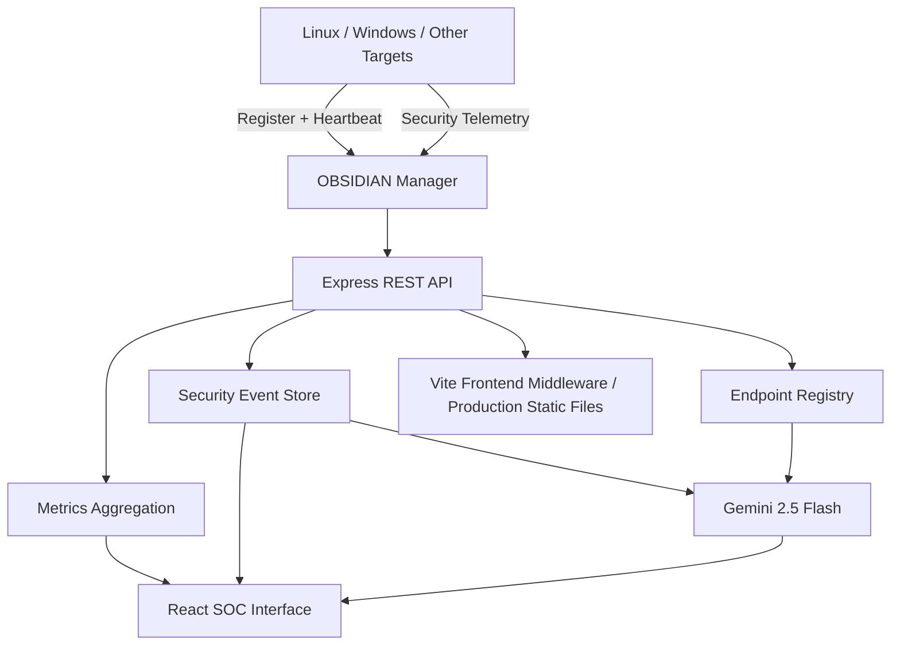

<div align="center">

# ◈ OBSIDIAN

### AI-Assisted Security Operations & Endpoint Monitoring Platform

**A centralized security operations cockpit for monitoring registered endpoints, collecting security telemetry, investigating events, and generating evidence-grounded AI threat analysis.**

[](https://www.typescriptlang.org/)
[](https://react.dev/)
[](https://vite.dev/)
[](https://nodejs.org/)
[](https://expressjs.com/)
[](https://ai.google.dev/)

</div>

---

## Overview

**OBSIDIAN** is an AI-assisted security monitoring and operations platform designed to bring endpoint visibility, security-event monitoring, and threat investigation into one centralized interface.

It follows a manager-and-agent architecture: target systems register with the OBSIDIAN manager, periodically send heartbeat information, and report security telemetry. The manager aggregates this information, exposes operational metrics and event data through a REST API, and can use Google Gemini to analyze the collected evidence.

The goal is to make security operations easier to observe and investigate by combining endpoint status, event context, severity classification, MITRE ATT&CK references, and AI-assisted analysis.

> **Core idea:** One security cockpit. Multiple monitored endpoints. Centralized telemetry. Context-aware AI assistance.

## Key Capabilities

### 1. Endpoint / Agent Management
- Register monitored target systems with a unique agent ID.
- Track hostname, IP address, operating system, OS version, agent version, group, and tags.
- Receive periodic heartbeats from registered endpoints.
- Determine whether an endpoint is active or offline based on heartbeat freshness.
- Track reported-event counts for each endpoint.
- Decommission an endpoint and remove its associated events from the current in-memory state.

The server currently accepts these operating-system identifiers: `linux`, `windows`, `macos`, and `kubernetes`.

### 2. Security Telemetry Ingestion
Registered agents can submit structured security events to the manager.

Events support:
- Severity: `critical`, `high`, `medium`, `low`
- Categories: authentication, process injection, network anomaly, privilege escalation, file integrity, and command-and-control beaconing
- Source and destination network information
- Protocol and destination-port context
- MITRE ATT&CK technique and tactic references
- Original structured event payload
- Investigation status and timestamp

### 3. Security Event Monitoring
- Retrieve collected events through the REST API.
- Filter by severity and agent.
- Search event titles, hostnames, IP addresses, MITRE references, and raw event payloads.
- Limit the number of returned events.
- Update an event's investigation status.

### 4. SOC Metrics
The metrics endpoint provides an operational snapshot, including:
- Total registered endpoints
- Currently online endpoints
- Critical, high, medium, and low unresolved alerts
- Total unresolved alerts
- Total events reported by targets
- A recent-event rate estimate (events per second)

### 5. AI Threat Analysis
OBSIDIAN integrates the **Google Gemini API** through Google's `@google/genai` SDK.

When `GEMINI_API_KEY` is configured, the manager uses `gemini-2.5-flash` to analyze recent target telemetry and registered endpoint context. The response is requested as structured JSON and includes:

- **Threat summary** — an evidence-based overview of received events
- **Kill-chain phase** — the tactic/phase supported by available evidence
- **Blast radius** — affected hosts identified from the supplied events
- **Attack path** — a chronological representation of relevant event activity
- **Recommended actions** — investigation guidance based on the supplied telemetry

The AI prompt explicitly instructs the model not to invent actors, findings, relationships, commands, or assets, and not to return executable containment commands.

If a Gemini API key is not configured, the server falls back to a basic telemetry-based summary. This fallback is not equivalent to an LLM investigation.

### 6. Endpoint Agent Installation Support
The manager exposes installer-script endpoints for persistent heartbeat agents:

- Linux: `GET /api/agent/install.sh`
- Windows: `GET /api/agent/install.ps1`

The generated scripts are designed to register a target when needed and periodically send heartbeat information to the manager.

---

## Technology Stack

| Layer | Technology | Purpose |
|---|---|---|
| Frontend | React 19 | Component-based user interface |
| Language | TypeScript | Type-safe application and server code |
| Build tooling | Vite 8 | Development server and production build |
| Styling | Tailwind CSS 4 | Utility-first styling |
| UI icons | Lucide React | Interface iconography |
| Motion | Motion | UI animation and transitions |
| Backend runtime | Node.js | JavaScript/TypeScript server runtime |
| Backend framework | Express 4 | REST API and HTTP server |
| TypeScript execution | tsx | Run the TypeScript server directly |
| AI integration | Google GenAI SDK | Gemini model integration |
| AI model | Gemini 2.5 Flash | Telemetry analysis and structured responses |
| Configuration | dotenv | Load environment variables |
| Unique identifiers | Node.js crypto | Generate agent and event identifiers |

### Architecture at a Glance



### Request Flow

1. A target runs its deployment/agent script.
2. The target registers with the manager if it is not already registered.
3. The agent periodically sends heartbeat information.
4. Security telemetry is submitted to the manager's ingestion endpoint.
5. The manager validates and stores the event in its current runtime state.
6. The frontend can retrieve endpoint information, events, and SOC metrics.
7. The AI analysis endpoint can send recent event and endpoint context to Gemini for a structured assessment.

---

## Project Structure

The repository currently includes the following top-level files and directories:

```text
OBSIDIAN/
├── public/
│   └── assets/
│       └── aistudio/
├── src/                 # React frontend source
├── .env.example         # Environment-variable template
├── .gitignore
├── index.html           # Frontend HTML entry point
├── metadata.json
├── package.json         # Dependencies and npm scripts
├── server.ts            # Express manager, REST API and agent scripts
├── tsconfig.json        # TypeScript configuration
├── vite.config.ts       # Vite configuration
└── README.md
```

---

## Getting Started

### Prerequisites

Install the following before running the project:

- [Node.js](https://nodejs.org/) — use a current version compatible with Vite 8
- npm — included with Node.js
- Git
- A Google Gemini API key (optional; required for Gemini-powered analysis)

### 1. Clone the Repository

```bash
git clone https://github.com/ADITYA-PADHIHARI/OBSIDIAN.git
cd OBSIDIAN
```

### 2. Install Dependencies

```bash
npm install
```

### 3. Configure Environment Variables

Create a `.env` file in the project root. You can start from the supplied example:

```bash
# macOS / Linux
cp .env.example .env
```

On Windows PowerShell:

```powershell
Copy-Item .env.example .env
```

Set the following values as needed:

```env
PORT=3000
GEMINI_API_KEY=your_gemini_api_key
```

- `PORT` — HTTP port for the OBSIDIAN manager. The server defaults to `3000` when this variable is not set.
- `GEMINI_API_KEY` — Google Gemini API key. Leave it unset if you want to use the server's basic telemetry-summary fallback.

Get a Gemini API key from [Google AI Studio](https://aistudio.google.com/apikey).

**Security:** Never commit `.env`, API keys, access tokens, or other secrets to Git. Keep real credentials out of screenshots, logs, and public issue reports.

### 4. Start the Development Server

```bash
npm run dev
```

The manager starts on:

```text
http://localhost:3000
```

The development server runs the Express manager with Vite middleware.

### 5. Create a Production Build

```bash
npm run build
```

Preview the built frontend with:

```bash
npm run preview
```

Run the server in production mode after building:

```bash
# macOS / Linux
NODE_ENV=production npm start
```

```powershell
# Windows PowerShell
$env:NODE_ENV = "production"
npm start
```

The production server serves the generated `dist/` directory.

### Available npm Scripts

| Command | Description |
|---|---|
| `npm run dev` | Start the manager and Vite development middleware |
| `npm run build` | Build the frontend with Vite |
| `npm run preview` | Preview the Vite production build |
| `npm start` | Start the server |
| `npm run lint` | Run the TypeScript compiler without emitting files |
| `npm run clean` | Remove generated build/server output (script uses `rm -rf`) |

---

## REST API Reference

The following routes are defined by the current `server.ts` implementation.

| Method | Endpoint | Description |
|---|---|---|
| `GET` | `/api/agents` | List registered agents and their computed online status |
| `POST` | `/api/agents/register` | Register a target endpoint |
| `POST` | `/api/agents/heartbeat` | Update an agent's heartbeat and optional resource/identity information |
| `POST` | `/api/agents/telemetry` | Submit a structured security event |
| `DELETE` | `/api/agents/:id` | Decommission an agent and remove its associated events |
| `GET` | `/api/events` | Retrieve and filter security events |
| `PATCH` | `/api/events/:id` | Update an event's status |
| `GET` | `/api/metrics` | Retrieve SOC-wide operational metrics |
| `POST` | `/api/ai/correlate` | Generate an AI-assisted telemetry analysis |
| `GET` | `/api/agent/install.sh` | Retrieve the Linux heartbeat-agent installer |
| `GET` | `/api/agent/install.ps1` | Retrieve the Windows heartbeat-agent installer |

### Example: Register an Agent

```http
POST /api/agents/register
Content-Type: application/json
```

```json
{
  "id": "endpoint-001",
  "hostname": "lab-linux-01",
  "ip": "192.168.1.20",
  "os": "linux",
  "osVersion": "Ubuntu 24.04",
  "agentVersion": "1.0.0",
  "group": "Lab",
  "tags": ["linux", "lab"]
}
```

The `id` is optional; the server generates one if it is not supplied. The hostname, IP address, supported OS identifier, and OS version are required.

### Example: Send a Heartbeat

```http
POST /api/agents/heartbeat
Content-Type: application/json
```

```json
{
  "id": "endpoint-001",
  "hostname": "lab-linux-01",
  "ip": "192.168.1.20",
  "osVersion": "Ubuntu 24.04",
  "cpuUsage": 18.5,
  "memoryUsage": 42.0
}
```

A heartbeat refreshes the agent's last-seen time. The server considers an agent online when its last heartbeat is no more than 45 seconds old.

### Example: Submit Security Telemetry

```http
POST /api/agents/telemetry
Content-Type: application/json
```

```json
{
  "agentId": "endpoint-001",
  "title": "Unusual authentication activity",
  "severity": "high",
  "category": "authentication",
  "mitreTechnique": "T1110",
  "mitreTactic": "Credential Access",
  "rawPayload": {
    "source_ip": "192.168.1.50",
    "dest_ip": "192.168.1.20",
    "dest_port": 22,
    "protocol": "SSH"
  }
}
```

The example is illustrative test data. Use only systems and telemetry you are authorized to monitor.

### Example: Query Events

```http
GET /api/events?severity=high&agentId=endpoint-001&limit=50
```

Supported query parameters:

| Parameter | Description |
|---|---|
| `q` | Search event text, host, IP, MITRE fields, and raw payload |
| `severity` | Filter by severity |
| `agentId` | Filter by registered agent |
| `limit` | Maximum number of returned events (server caps this at 500) |

### Example: Request AI Correlation

```http
POST /api/ai/correlate
Content-Type: application/json
```

```json
{
  "customPrompt": "Summarize the observed activity and identify the evidence-supported attack progression."
}
```

The analysis is limited to telemetry and registered target context supplied to the model. AI output should be treated as investigation assistance, not as a confirmed incident verdict.

---

## Data Handling & Current Implementation Notes

The current manager keeps its agent registry and event collection in **process memory**.

This has important implications:

- Registered agents and collected events are not persisted to a database.
- Restarting the server clears the current in-memory registry and event collection.
- This implementation is suitable for development, demonstrations, and controlled testing, but is not yet a durable production SIEM data store.
- The current API does not provide a complete authentication or authorization layer. Do not expose it directly to untrusted networks.
- Heartbeat status is derived from the most recent heartbeat; it is not proof that an endpoint is healthy or uncompromised.

These are implementation facts, not claims about future roadmap items.

---

## Security & Responsible Use

OBSIDIAN is intended for defensive security monitoring, authorized endpoint administration, and controlled security research.

Before deploying it:

- Monitor only devices, networks, and accounts for which you have explicit authorization.
- Protect the manager API behind appropriate network controls.
- Add authentication and role-based authorization before multi-user or internet-facing deployment.
- Use HTTPS in deployed environments.
- Protect API keys and agent identifiers.
- Validate and constrain incoming telemetry at the collection boundary.
- Review AI-generated findings before acting on them.
- Do not treat an AI recommendation as a substitute for incident-response procedures or human verification.

**OBSIDIAN is a development project and should not be considered a production-ready security product without additional hardening, persistence, access control, testing, and operational safeguards.**

---

## Roadmap

The following are potential areas for future development, not assertions that these features are already implemented:

- [ ] Persistent storage for agents, events, and investigation history
- [ ] Authentication, authorization, and role-based access control
- [ ] Secure agent-to-manager communication and enrollment
- [ ] Stronger endpoint telemetry collection and validation
- [ ] Real-time event delivery to the dashboard
- [ ] Advanced detection rules and event correlation
- [ ] MITRE ATT&CK technique mapping and investigation views
- [ ] Alert notifications and escalation workflows
- [ ] Audit logging and operational observability
- [ ] Automated tests and deployment documentation
- [ ] Containerized deployment and environment-specific configuration

---

## Contributing

Contributions, suggestions, bug reports, and improvements are welcome.

1. Fork the repository.
2. Create a feature branch.
3. Make focused changes and test them locally.
4. Run the available checks.
5. Open a pull request with a clear description of the change.

```bash
git checkout -b feature/your-feature
git add .
git commit -m "feat: describe your change"
git push origin feature/your-feature
```

For security-sensitive issues, avoid publishing exploit details, credentials, or private endpoint data in public issues.

---

## License

No license file was visible in the repository snapshot when this README was prepared. Until a license is added by the project owner, do not assume that the code is open source or that reuse and redistribution are permitted.

---

<div align="center">

**OBSIDIAN — Observe. Investigate. Understand.**

Built for visibility, clarity, and smarter defensive security operations.

[Repository](https://github.com/ADITYA-PADHIHARI/OBSIDIAN)

</div>

